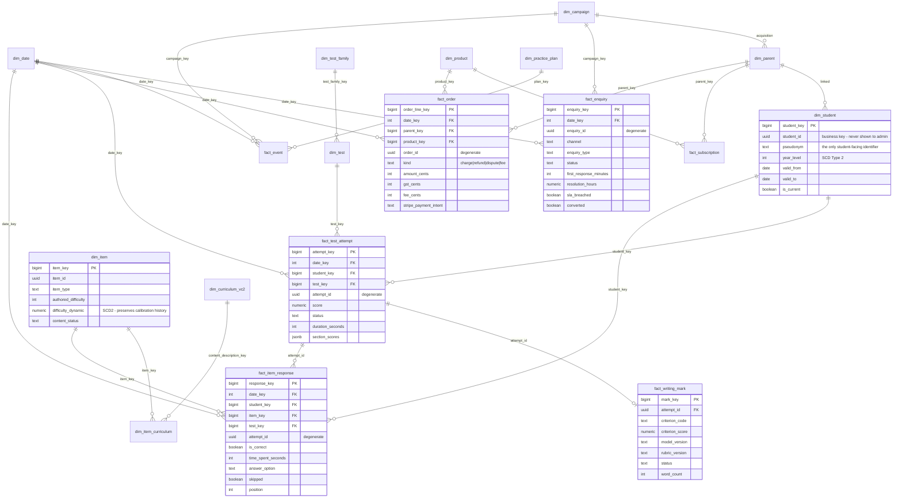

# Mock Tests Platform — BI & Reporting Data Model (Part 2 of 4)

> **Deliverables 6–9**: event tracking plan; enquiry table inspection and migration; reporting
> data model (Mermaid ERD + DDL); views, materialised views, `pg_cron` schedules and RLS.
> Read `11-bi-reporting-design.md` first — report IDs (S1, P3, A11 …) and metric names are
> defined there and used unchanged here.

---

## 6. Deliverable 6 — Event tracking plan

### 6.1 Naming convention: adopt the one that already exists

The brief's examples use `snake_case` (`test_started`, `item_answered`). The codebase already has
a **closed, typed `SCREAMING_SNAKE_CASE` catalogue** in `src/lib/funnel/events.ts`
(`DIAGNOSTIC_STARTED`, `CHECKOUT_STARTED`, `PAYWALL_TRIGGERED`, …) enforced at compile time and
validated again server-side by `isKnownEvent()`.

**Decision: keep `SCREAMING_SNAKE_CASE`.** Two conventions in one event store is how analytics
dies — the exact failure the existing file's header comment warns about. The brief's examples map
one-to-one:

| Brief example | Platform event | Status |
|---|---|---|
| `test_started` | `TEST_STARTED` | **new** (`DIAGNOSTIC_STARTED` covers only the free benchmark) |
| `item_answered` | `ITEM_ANSWERED` | **new** |
| `test_submitted` | `TEST_SUBMITTED` | **new** |
| `checkout_started` | `CHECKOUT_STARTED` | exists |
| `enquiry_created` | `ENQUIRY_CREATED` | **new** |
| `daily_target_met` | `DAILY_TARGET_MET` | **new** |

### 6.2 Convention rules

1. **`SUBJECT_VERB` in `SCREAMING_SNAKE_CASE`**, past-tense verb. `TEST_SUBMITTED`, never
   `SUBMIT_TEST`.
2. **Closed vocabulary.** A new event requires a code change to `EVENT_STEP`. Unknown names are
   dropped by `/api/events`.
3. **Property names are `camelCase`** inside `props`, matching the existing `TrackEventInput`.
4. **Every event maps to a funnel step** via `EVENT_STEP`, so nothing is orphaned.
5. **No PII in `props`.** No names, emails, phone numbers or free-text answers. Enforced by the
   `sanitizeProps` allow-list plus a CI check (`14-…md` §15.4).
6. **Identity is server-derived.** `user_id` comes from the Supabase session, never the body —
   already implemented in `/api/events`.
7. **Bounded payload.** Already enforced: 20 events/request, 16 KB body, 12 props, 256-char
   strings.

### 6.3 New and amended events

`step` values use the existing `FUNNEL_STEPS` vocabulary. Events marked **⚠ high-volume** need
the batching and retention treatment in §6.5.

| Event | Step | Properties | Fires from | Why it exists |
|---|---|---|---|---|
| `TEST_STARTED` | first_value | `testId`, `testFamily`, `yearLevel`, `assignmentId?`, `isAdaptive` | `POST /api/runner/start`, after the attempt row commits | Separates paid from diagnostic starts. `DIAGNOSTIC_STARTED` covers only the free benchmark, so A4's completion rate currently has no denominator for paid tests. |
| `ITEM_ANSWERED` ⚠ | first_value | `attemptId`, `itemId`, `position`, `timeSpentSeconds`, `skipped`, `changed` | Runner, on answer commit — **never on keystroke** | The only source for `pace_vs_expected`, item-level `skip_rate`, `median_time_per_item`, `guess_rate`. **`isCorrect` is deliberately excluded** — correctness in an analytics event would leak results into a table student sessions write to. |
| `TEST_SUBMITTED` | first_value | `attemptId`, `testId`, `durationSeconds`, `itemsAnswered`, `itemsTotal`, `submitOutcome` | `POST /api/runner/submit`, after commit | `submitOutcome: 'ok' \| 'failed'` sources `failed_submission_rate` — the most damaging failure in the product. |
| `TEST_ABANDONED` | first_value | `attemptId`, `testId`, `lastPosition`, `idleSeconds` | Server-side sweep of attempts past expiry | A4's `abandonment_point` needs abandonment distinguished from submission. Derived, not client-fired. |
| `WRITING_MARK_COMPLETED` | first_value | `attemptId`, `modelVersion`, `rubricVersion`, `queueMs`, `attemptNumber`, `outcome` | `POST /api/jobs/writing-eval` | Sources `mark_queue_time_p95`, `mark_retry_rate`, `mark_failure_rate`. **Requires version capture that does not exist today** (deliverable 11). |
| `WRITING_MARK_FLAGGED` | readiness_report | `attemptId`, `flaggedByRole`, `reason` | Parent P6 / Tutor T6 flag action | Sources `mark_flag_rate`, split by role. |
| `ITEM_FLAGGED` | first_value | `itemId`, `testId`, `flaggedByRole`, `reason` | Student / tutor / parent flag action | Replaces the untimestamped `questions.flag_count`, making `item_flag_rate` period-accurate. |
| `ENQUIRY_CREATED` | acquire | `enquiryId`, `channel`, `enquiryType` | Enquiry ingest, all three channels | Joins enquiries into the funnel so `enquiry_to_customer_rate` is computable. **No contact details.** |
| `ENQUIRY_FIRST_RESPONDED` | acquire | `enquiryId`, `responseMinutes` | Admin reply action | SLA measurement must be event-sourced, not inferred from a timestamp column that can be backfilled. |
| `ENQUIRY_RESOLVED` | acquire | `enquiryId`, `resolutionHours`, `outcome` | Admin close action | `resolution_hours`, `enquiry_to_customer_rate`. |
| `DAILY_TARGET_MET` | onboard | `dateKey`, `targetUnits`, `completedUnits` | Nightly job, per student | Sources `daily_target_adherence`. **Computed server-side**, never client-asserted — otherwise a client could report targets met that were not. |
| `DAILY_TARGET_MISSED` | onboard | `dateKey`, `targetUnits`, `completedUnits` | Nightly job | The complement. Parent-facing only; framed as "days completed" in the UI (B4, B5). |
| `PRACTICE_PLAN_CHANGED` | onboard | `examDate?`, `restDaysAdded`, `totalUnits?` | Parent P9 save | Without it, an S2 recalculation cannot be attributed to a plan change rather than a date passing. |
| `CONSENT_GRANTED` / `CONSENT_REVOKED` | onboard | `studentId`, `tutorId`, `purpose` | Parent P10 | Consent must be event-sourced so a revoked-then-regranted history stays auditable. |
| `ERROR_OCCURRED` ⚠ | cross-cutting | `route`, `errorClass`, `attemptId?`, `phase` | Global error boundary + API error handler | Sources `test_error_rate`. **`phase: 'during_test'` is what makes the metric meaningful** — an error on a marketing page is not an error during a test. No stack traces or messages in `props`: they can contain user input. |
| `REPORT_VIEWED` | readiness_report | `reportId`, `studentId?` | Each report component mount | Proves which reports are actually used. A report nobody opens is a report to delete — this is the metric that keeps the inventory MECE over time. |

### 6.4 Device and session context (fixes CRO requirement C9)

`funnel_events` has no device column. Rather than adding a client-supplied property (spoofable),
`/api/events` derives it server-side and the ETL writes it to `fact_event`:

```typescript
// src/app/api/events/device.ts
type DeviceClass = 'mobile' | 'tablet' | 'desktop' | 'unknown'

/**
 * Coarse device class: client hints first, User-Agent second.
 * Server-derived, never body-supplied — a client that could set its own device
 * segment could manufacture a 100%-converting cohort.
 */
export function classifyDevice(req: Request): DeviceClass {
  const mobile = req.headers.get('sec-ch-ua-mobile')
  if (mobile === '?1') return 'mobile'
  if (mobile === '?0') return 'desktop'

  const ua = req.headers.get('user-agent') ?? ''
  if (/iPad|Tablet|PlayBook|Silk/i.test(ua)) return 'tablet'
  if (/Mobi|Android|iPhone|iPod/i.test(ua)) return 'mobile'
  return ua ? 'desktop' : 'unknown'
}
```

`fact_event` also carries `session_id` (from the existing `mt_aid` cookie) so sessions-per-week
and funnel paths are computable without a second identifier.

### 6.5 High-volume events: batching and retention

`ITEM_ANSWERED` and `ERROR_OCCURRED` dominate volume — roughly one `ITEM_ANSWERED` per question
per attempt. Three controls:

1. **Client batches.** `/api/events` already accepts up to 20 events per request. The runner
   flushes on a 10-event or 15-second trigger and on `visibilitychange`, so answers survive a
   closed tab. **Never one request per answer** — that alone would break the 2s budget and the
   serverless bill.
2. **`fact_event` is partitioned monthly by `date_key`** from phase 2 (`pg_partman` is available
   on this project).
3. **Retention differs by event class**, per privacy requirement 5:

| Class | Examples | Retention | Rationale |
|---|---|---|---|
| Identity-linked behavioural | `ITEM_ANSWERED`, `TEST_SUBMITTED`, `REPORT_VIEWED` | 24 months, then aggregated monthly | Enough for longitudinal trend (P4) without indefinite child-level retention |
| Acquisition / funnel | `LANDING_VIEWED`, `SIGNUP_COMPLETED`, `CHECKOUT_*` | 36 months | Needed for LTV and cohort retention (A10) |
| Operational | `ERROR_OCCURRED` | 90 days | Debugging value decays fast |
| Financial | Stripe webhook-derived | 7 years | Australian tax record-keeping |
| Consent | `CONSENT_GRANTED` / `CONSENT_REVOKED` | Life of account + 7 years | Evidence of lawful basis must outlive the processing |

Retention is enforced by a `pg_cron` job dropping the oldest partition, and by
`reporting.retention_policy`, so the periods are **data, not code** — reviewable without a deploy.

**No PII in analytics tables — the mechanism.** Three layers, because a policy stated once is a
policy broken once:
- `sanitizeProps` allow-lists primitive types and caps lengths (already implemented).
- `fact_event` has no `email`, `name` or `phone` column, and no free-text column at all.
- A CI check greps the reporting DDL for prohibited column names and fails the build (§15.4).

---

## 7. Deliverable 7 — Enquiry table: inspection results and migration

### 7.1 Inspection (run before any migration, as required)

Three independent checks against the live database `ekdjrvjgrhpqolthbznr`:

```sql
-- (1) Catalogue sweep across every schema, including the requested similar names
SELECT n.nspname AS schema, c.relname AS relation, c.relkind,
       to_regclass(quote_ident(n.nspname)||'.'||quote_ident(c.relname)) AS regclass
FROM pg_class c JOIN pg_namespace n ON n.oid = c.relnamespace
WHERE c.relkind IN ('r','v','m','p','f')
  AND n.nspname NOT IN ('pg_catalog','information_schema','pg_toast')
  AND (c.relname ~* 'enquir|inquir|contact|lead|message|ticket|support');

-- (2) Direct existence probes
SELECT to_regclass('public.enquiries')       AS enquiries,
       to_regclass('public.enquiry')         AS enquiry,
       to_regclass('public.contacts')        AS contacts,
       to_regclass('public.leads')           AS leads,
       to_regclass('public.messages')        AS messages,
       to_regclass('public.support_tickets') AS support_tickets;

-- (3) information_schema cross-check of all public tables
SELECT table_name FROM information_schema.tables
WHERE table_schema = 'public' ORDER BY table_name;
```

**Results**

| Probe | Result |
|---|---|
| `enquiry` / `enquiries` | **Not found** in any schema |
| `contacts` | **Not found** |
| `leads` | **Not found** |
| `messages` | Found only as `realtime.messages` — Supabase Realtime internal, partitioned, **not** an enquiry table |
| `support_tickets` | **Not found** |
| Closest matches in `public` | `notifications` (in-app notifications *to* `auth.users`, not inbound enquiries); `email_log` (**defined in `011_funnel.sql`, not applied**, and it is an *outbound* send ledger) |

The 18 tables in `public` are: `app_user_roles`, `assignments`, `attempts`, `entitlements`,
`notifications`, `parent_student_links`, `processed_jobs`, `processed_webhook_events`,
`product_tests`, `products`, `purchases`, `questions`, `responses`, `student_profiles`,
`test_questions`, `test_sections`, `tests`, `writing_evaluations`. **All have 0 rows.**

**Conclusion: no enquiry table exists.** There are no columns, constraints or row counts to list.
Branch 3 of the brief applies — a create migration is required, no existing column is touched,
and the "additive only, never drop or rename" constraint is satisfied trivially.

**Related finding — the contact page has no form.** `src/app/(public)/contact/page.tsx` is a
static page with two `mailto:` links (`CONTACT.supportEmail`, `CONTACT.privacyEmail`). There is
no web form, no chat widget and no inbound email parser anywhere in the repo. So **none of the
three channels the brief requires currently writes to anything.** The migration creates the
tables; §7.3 specifies how each channel populates them.

### 7.2 Two-table split: enquiries and restricted contacts

The brief requires contact details in a **separate restricted table, excluded from the reporting
schema and admin dashboards**. The split is by column, not by flag:

| `public.enquiries` (reportable) | `public.enquiry_contacts` (restricted) |
|---|---|
| `id`, `channel`, `received_at`, `enquiry_type`, `parent_user_id`, `status`, `assigned_to`, `first_response_at`, `resolved_at`, `outcome`, `converted_order_id`, UTM fields | `enquiry_id` (PK/FK), `full_name`, `email`, `phone`, `message_body` |
| Visible to Admin in A13 | **No `reporting` view. No dashboard surface. Separate `GRANT`.** |
| **No free-text field at all** | Read through one `SECURITY DEFINER` function that logs the read |

The consequence that matters: **`fact_enquiry` can be built from `public.enquiries` alone**, so
the reporting schema has no path to a message body. That is a structural guarantee, not a policy
— and it is what makes "excluded from the reporting schema" true rather than intended.

### 7.3 How each channel writes into the table

**The brief left two placeholders unfilled**: `[email ingestion method]` and `[chat tool]`. I have
not chosen vendors on your behalf — that is a purchasing and privacy decision (a chat tool is a
third-party processor of children-adjacent data and needs a Privacy Act assessment). What follows
is a **channel-agnostic ingest contract** plus a recommended option for each, so the schema does
not change whichever you pick. Logged as **A-16**, question **Q-6**.

**The single rule: every channel writes through one function.**

```sql
public.ingest_enquiry(
  p_channel        text,     -- 'web_form' | 'email' | 'chat'
  p_received_at    timestamptz,
  p_enquiry_type   text,
  p_source_ref     text,     -- provider message id / transcript id, for idempotency
  p_parent_user_id uuid,     -- nullable
  p_utm            jsonb,    -- nullable
  p_contact        jsonb     -- { fullName, email, phone, messageBody } -> restricted table
) RETURNS uuid
```

It inserts into **both** tables in one transaction, so an enquiry can never exist without its
contact row and a contact row can never exist without an enquiry. It is idempotent on
`(channel, source_ref)`, which is what stops a retried webhook creating a duplicate. Only
`p_contact` touches the restricted table, and it never leaves the function's scope.

| Channel | Method | Idempotency key | Notes |
|---|---|---|---|
| **Web form** | New `POST /api/enquiries` from a form on `/contact`. Rate-limited, honeypot field, bot challenge | `web_form:` + server-generated UUID | The form does not exist — `/contact` is `mailto:` only. Building it is part of this work, not an integration. |
| **Email** | **Recommended: an inbound-email webhook** (provider parses inbound mail, POSTs to a verified endpoint), handled by a QStash job. The repo already depends on `@upstash/qstash` and already verifies webhook signatures for Stripe, so this reuses two established patterns | Provider message-ID | **Do not poll IMAP from a serverless function** — long-lived sockets do not survive on Vercel and a polling loop will silently stop. Alternative staying in the current stack: a Resend inbound endpoint; `email_log` in `011` already assumes Resend. |
| **Chat** | **Recommended: an embedded widget whose vendor provides a conversation webhook**, normalised to the same `ingest_enquiry` call by a QStash handler | Provider transcript ID | Vendor not chosen (Q-6). Requirements: (a) server-side webhook, (b) AU/APAC data residency option, (c) signed webhook. A widget offering only a dashboard export cannot meet the SLA metrics — `first_response_at` would be a manual re-key. |

**Why a function and not three route handlers.** Three handlers means three places to get
idempotency, the two-table transaction and UTM normalisation right. One function means one place,
and the database enforces the invariant even if a handler is written badly.

**Attribution.** UTM comes from the same `normalizeUtm()` already in `src/lib/funnel/events.ts`,
reused rather than reimplemented, so an enquiry and an event from the same visitor carry identical
UTM and can be joined. For email and chat UTM is usually absent, so `fact_enquiry` treats
`channel` as primary attribution and UTM as best-effort; `enquiry_to_customer_rate` is reported
**by channel first, by campaign only where UTM exists**.

### 7.4 Migration

Saved to `mock-tests/supabase/migrations/012_enquiries.sql`. **Not applied** — see §7.6.

```sql
-- 012_enquiries.sql
-- Inbound enquiries across three channels, with contact details split into a
-- restricted table the reporting schema cannot reach.
--
-- INSPECTION FIRST (required): to_regclass and information_schema both confirm no
-- enquiry / contact / lead / message / ticket table exists. `messages` matches only
-- realtime.messages (Supabase internal). This is a CREATE, not an ALTER, so no
-- existing column is dropped or renamed.
--
-- Idempotent: safe to re-run.

CREATE TABLE IF NOT EXISTS public.enquiries (
  id                 uuid PRIMARY KEY DEFAULT gen_random_uuid(),

  channel            text NOT NULL CHECK (channel IN ('web_form','email','chat')),
  received_at        timestamptz NOT NULL DEFAULT now(),

  -- Closed list on purpose: a free-text type column would let a message body leak
  -- into a reportable table. Anything unclassifiable is 'other' and is read in the
  -- restricted table by a human.
  enquiry_type       text NOT NULL DEFAULT 'other' CHECK (enquiry_type IN (
                       'billing','technical','privacy','accessibility',
                       'product_question','refund','complaint','other')),

  -- Nullable: most enquiries arrive before anyone has an account.
  parent_user_id     uuid REFERENCES auth.users(id) ON DELETE SET NULL,

  status             text NOT NULL DEFAULT 'new' CHECK (status IN (
                       'new','triaged','in_progress','waiting_on_customer',
                       'resolved','closed','spam')),
  assigned_to        uuid REFERENCES auth.users(id) ON DELETE SET NULL,

  first_response_at  timestamptz,
  resolved_at        timestamptz,

  outcome            text CHECK (outcome IN (
                       'answered','refunded','escalated','no_action',
                       'spam','duplicate','withdrawn')),

  -- The order this enquiry produced, for enquiry_to_customer_rate.
  converted_order_id uuid REFERENCES public.purchases(id) ON DELETE SET NULL,
  converted_at       timestamptz,

  -- Provider message / transcript id. The idempotency key for retried webhooks.
  ingest_source_ref  text,

  -- UTM, normalised by the same helper the event pipeline uses.
  utm_source         text,
  utm_medium         text,
  utm_campaign       text,
  utm_term           text,
  utm_content        text,

  created_at         timestamptz NOT NULL DEFAULT now(),
  updated_at         timestamptz NOT NULL DEFAULT now(),

  -- Caught at write time rather than discovered in a dashboard as a negative SLA.
  CONSTRAINT enquiries_timeline_sane CHECK (
    first_response_at IS NULL OR resolved_at IS NULL OR first_response_at <= resolved_at),
  CONSTRAINT enquiries_resolved_has_outcome CHECK (
    status NOT IN ('resolved','closed') OR outcome IS NOT NULL)
);

CREATE UNIQUE INDEX IF NOT EXISTS idx_enquiries_ingest_source_ref
  ON public.enquiries (channel, ingest_source_ref)
  WHERE ingest_source_ref IS NOT NULL;

CREATE INDEX IF NOT EXISTS idx_enquiries_status_received
  ON public.enquiries (status, received_at DESC);
CREATE INDEX IF NOT EXISTS idx_enquiries_assigned
  ON public.enquiries (assigned_to, status) WHERE assigned_to IS NOT NULL;
CREATE INDEX IF NOT EXISTS idx_enquiries_parent
  ON public.enquiries (parent_user_id) WHERE parent_user_id IS NOT NULL;
-- Drives the SLA-breach alert: unresponded, oldest first.
CREATE INDEX IF NOT EXISTS idx_enquiries_sla_open
  ON public.enquiries (received_at)
  WHERE first_response_at IS NULL AND status NOT IN ('spam','closed');
```

The restricted table:

```sql
CREATE TABLE IF NOT EXISTS public.enquiry_contacts (
  enquiry_id   uuid PRIMARY KEY REFERENCES public.enquiries(id) ON DELETE CASCADE,
  full_name    text,
  email        citext,   -- case-insensitive match when linking to an account
  phone        text,
  message_body text,
  created_at   timestamptz NOT NULL DEFAULT now()
);

ALTER TABLE public.enquiry_contacts ENABLE ROW LEVEL SECURITY;
-- Deliberately NO policy for any role. Reachable only through
-- public.read_enquiry_contact(p_enquiry_id uuid, p_task_reason text),
-- SECURITY DEFINER, which inserts into public.enquiry_contact_access_log
-- before returning. Same shape as the admin drill-down rule (11-…md §3.4).
```

`citext` is **available but not installed** on this project, and on Supabase must be created in
the `extensions` schema. The migration runs
`CREATE EXTENSION IF NOT EXISTS citext WITH SCHEMA extensions;` — a deployment detail, not a
design risk. `ingest_enquiry()`, its RLS and `fact_enquiry` are in the migration file.

### 7.5 Enquiry RLS

| Role | `enquiries` | `enquiry_contacts` |
|---|---|---|
| Anonymous | — | — |
| Student | — | — |
| Parent | SELECT own (`parent_user_id = auth.uid()`) | — |
| Tutor | — | — |
| Test Creator | — | — |
| Admin | ALL | via `read_enquiry_contact()` only, audited |
| `reporting_ro` | SELECT, for the `fact_enquiry` ETL | **no grant** |

A parent can see their own enquiry history, which is what makes A13's `waiting_on_customer`
status actionable instead of a number only staff can act on.

### 7.6 What I did **not** run, and why

No migration was applied. Three reasons, in order of severity:

1. **`010_subscriptions.sql` will fail** on this database (`11-…md` §0.2). Applying 012 while an
   earlier migration aborts would leave the migration history inconsistent.
2. The brief requires inspection results to be shown **before** any migration runs. They are
   above and have not yet been acknowledged.
3. `012` depends on `public.purchases` (exists) and, for the reporting fact, on the `reporting`
   schema created by `013`. Applying out of order would need repair.

**Recommended apply order**: fix `010` → apply `010`, `011` → `012_enquiries.sql` →
`013_reporting_foundation.sql` → `014_reporting_mvs_and_rls.sql`.
Say the word and I will execute it against `ekdjrvjgrhpqolthbznr`.

---

## 8. Deliverable 8 — Reporting data model

### 8.1 Grain and keys

Every object states its grain, because a fact table without a stated grain will be joined wrongly
within a quarter.

**Dimensions**

| Object | Grain (one row per) | Business key | Surrogate key | SCD | Why that SCD type |
|---|---|---|---|---|---|
| `dim_date` | calendar day, Australia/Melbourne | `date_key` (int YYYYMMDD) | = business key | none (static) | Conformed. Pre-generated 2024–2030. Carries `is_weekend`, `is_vic_public_holiday`, `is_school_term`. |
| `dim_student` | student, current + historical | `student_id` (uuid) | `student_key` (bigint) | **Type 2** on `year_level` | A Year 3 attempt must stay a Year 3 attempt forever. Type 1 would silently re-label last year's data and break every trend. |
| `dim_parent` | parent account | `user_id` (uuid) | `parent_key` (bigint) | Type 1 | Only `signup_date` and `campaign_key` matter; neither needs history. **No email, no name.** |
| `dim_item` | question, versioned | `item_id` (uuid) | `item_key` (bigint) | **Type 2** on `difficulty_dynamic`, `status`, `correct_answer` | `questions.difficulty_dynamic` is overwritten in place today, destroying calibration history. Type 2 is what makes `calibration_drift` (A2) measurable at all. |
| `dim_curriculum_vc2` | VC2 content description | `content_description_code` | `content_description_key` | Type 1 | Curriculum text changes rarely and never needs historical restating. **Empty until the VC2 mapping is authored (A-02).** |
| `dim_item_curriculum` | item × content description | (`item_key`, `content_description_key`) | — | Type 1 | Bridge: one item can serve several content descriptions, weighted from the `skill_*` columns. |
| `dim_test` | test, versioned | `test_id` (uuid) | `test_key` (bigint) | **Type 2** on `status`, `time_limit_mins`, `is_free` | Republishing with a new time limit must not restate historical completion rates. |
| `dim_test_family` | test family | `exam_type` | `test_family_key` | Type 1 | Maps the existing enum (`BENCHMARK`, `NAPLAN_STYLE`, `OLYMPIAD`, `SELECTIVE`) to parent-facing labels. |
| `dim_product` | product, versioned | `product_id` (uuid) | `product_key` (bigint) | **Type 2** on `price_cents`, `is_bundle`, `status` | A price change must not restate last quarter's revenue. `is_bundle` **does not exist on `public.products`** — additive column required. |
| `dim_campaign` | channel × campaign × content | UTM string hash | `campaign_key` (bigint) | Type 1 | UTM strings are immutable once captured. Carries nullable `monthly_spend_cents` (A-08). |
| `dim_practice_plan` | student plan, versioned | `plan_id` | `plan_key` (bigint) | **Type 2** | A plan change must not restate historical `daily_target_adherence`. |
| `dim_year_level_cap` | year level | `year_level` | — | Type 1 | Config for the S2 cap. **Seeded NULL — you must set it (Q-4).** |

**Facts**

| Object | Grain (one row per) | Degenerate keys | Measures | Partitioning |
|---|---|---|---|---|
| `fact_item_response` | student response to one item in one attempt | `attempt_id` | `is_correct`, `time_spent_seconds`, `answer_option`, `skipped`, `position` | monthly by `date_key` (phase 2) |
| `fact_test_attempt` | one attempt | `attempt_id` | `score`, `raw_accuracy`, `weighted_score`, `duration_seconds`, `status`, normalised `section_scores` | monthly (phase 2) |
| `fact_writing_mark` | one rubric criterion mark for one attempt | `evaluation_id` | `criterion_score`, `max_score`, `word_count` | none at launch volume |
| `fact_order` | one Stripe order **line item** | `order_id`, `stripe_payment_intent` | `amount_cents`, `gst_cents`, `fee_cents`, `kind` | monthly |
| `fact_subscription` | one subscription period | `subscription_id` | `amount_cents`, `normalised_monthly_cents`, `status` | none |
| `fact_enquiry` | one enquiry | `enquiry_id` | `first_response_minutes`, `resolution_hours`, `sla_breached`, `converted` | none |
| `fact_event` | one tracked product event | `event_id` | none — events are counts | monthly by `date_key` (phase 2) |

**`fact_order` grain is the line item, not the order.** That is what makes `bundle_attach_rate`
computable: a bundle order has several lines, and an order-grain fact cannot distinguish a bundle
from a single-product purchase. `order_id` is retained as a degenerate dimension so orders can be
regrouped.

**`fact_writing_mark` grain is the criterion, not the attempt.** P6 needs a trend *per criterion*,
which an attempt-grain fact cannot express. The overall writing score lives on
`fact_test_attempt`, so there is exactly one place to read a total and no risk of a criterion sum
disagreeing with it.

### 8.2 Mermaid ERD



`public.enquiry_contacts` is **deliberately absent from this diagram** — it has no relationship to
anything in the reporting schema, which is the entire point of §7.2.

### 8.3 DDL — schema, role and guard rails

```sql
-- 013_reporting_foundation.sql  (extract)

CREATE SCHEMA IF NOT EXISTS reporting;

-- pg_cron is AVAILABLE (1.6.4) but NOT INSTALLED on this project.
-- Required for every refresh schedule in §9.4.
CREATE EXTENSION IF NOT EXISTS pg_cron;
CREATE EXTENSION IF NOT EXISTS citext WITH SCHEMA extensions;

-- ----------------------------------------------------------------------------
-- The reporting role: the mechanism behind "give reporting queries their own
-- database role with a statement timeout".
--
-- NOLOGIN, granted to the existing roles, so the API does SET LOCAL ROLE inside
-- a transaction instead of needing a second connection string through Supavisor.
-- SET ROLE changes current_user but NOT the JWT claims, so auth.uid() keeps
-- working and RLS still applies - which is exactly right: a scoped role, not a
-- bypass.
-- ----------------------------------------------------------------------------
DO $$ BEGIN
  IF NOT EXISTS (SELECT 1 FROM pg_roles WHERE rolname = 'reporting_ro') THEN
    CREATE ROLE reporting_ro NOLOGIN;
  END IF;
END $$;

GRANT reporting_ro TO authenticated, service_role, postgres;

GRANT USAGE ON SCHEMA reporting TO reporting_ro;
-- SELECT is granted per reporting object below. Deliberately NOT granted:
--   SELECT ON public.attempts / public.responses / public.writing_evaluations
-- so a reporting query physically cannot read a results table.

ALTER ROLE reporting_ro SET statement_timeout = '5s';
ALTER ROLE reporting_ro SET idle_in_transaction_session_timeout = '10s';
ALTER ROLE reporting_ro SET lock_timeout = '2s';
-- Belt and braces: the API also issues SET LOCAL, because ALTER ROLE applies at
-- login and SET LOCAL ROLE does not re-trigger it.
```

**Why `SET LOCAL ROLE` and not a separate login role.** Supabase routes connections through
Supavisor with a fixed set of login roles. Adding one means a second connection string, a second
pool and a second secret to rotate. `SET LOCAL ROLE reporting_ro` inside a transaction achieves
the same privilege boundary with none of that and — critically — leaves `auth.uid()` intact so RLS
still filters by the real caller. The role is a **capability reduction, not an identity swap**.

```typescript
// src/lib/reporting/connection.ts
/**
 * Run a reporting query under the reporting_ro role with a hard timeout.
 *
 * Both SET LOCALs are required: ALTER ROLE ... SET only applies at login, and
 * SET LOCAL ROLE does not re-login. Without the explicit timeout a runaway
 * aggregate holds a connection for the pool's default, which is how a reporting
 * query eventually does slow down live tests.
 */
export async function withReportingRole<T>(
  fn: (sql: Sql) => Promise<T>
): Promise<T> {
  return sql.begin(async (tx) => {
    await tx.unsafe('SET LOCAL ROLE reporting_ro')
    await tx.unsafe("SET LOCAL statement_timeout = '5s'")
    await tx.unsafe("SET LOCAL lock_timeout = '2s'")
    return fn(tx)
  })
}
```

### 8.4 DDL — dimensions

```sql
CREATE TABLE reporting.dim_date (
  date_key              integer PRIMARY KEY,           -- YYYYMMDD, Australia/Melbourne
  the_date              date    NOT NULL UNIQUE,
  year                  smallint NOT NULL,
  quarter               smallint NOT NULL,
  month                 smallint NOT NULL,
  week_of_year          smallint NOT NULL,
  day_of_week           smallint NOT NULL,             -- 1 = Monday
  is_weekend            boolean NOT NULL,
  is_vic_public_holiday boolean NOT NULL DEFAULT false,
  is_school_term        boolean NOT NULL DEFAULT true, -- ASSUMPTION until a term calendar is supplied
  month_start           date NOT NULL,
  month_end             date NOT NULL
);

CREATE TABLE reporting.dim_test_family (
  test_family_key smallint PRIMARY KEY,
  exam_type       text NOT NULL UNIQUE,   -- BENCHMARK|NAPLAN_STYLE|OLYMPIAD|SELECTIVE
  family_label    text NOT NULL,          -- parent-facing wording
  is_diagnostic   boolean NOT NULL DEFAULT false
);

CREATE TABLE reporting.dim_student (                    -- SCD Type 2
  student_key bigint GENERATED BY DEFAULT AS IDENTITY PRIMARY KEY,
  student_id  uuid   NOT NULL,      -- business key; NEVER exposed in an admin payload
  pseudonym   text   NOT NULL,      -- from student_profiles.username
  year_level  smallint NOT NULL CHECK (year_level BETWEEN 2 AND 8),
  valid_from  date NOT NULL,
  valid_to    date NOT NULL DEFAULT '9999-12-31',
  is_current  boolean NOT NULL DEFAULT true,
  UNIQUE (student_id, valid_from)
);
CREATE INDEX idx_dim_student_current ON reporting.dim_student (student_id) WHERE is_current;
-- No email. No name. No parent contact detail. Same rule applies to dim_parent.

CREATE TABLE reporting.dim_parent (
  parent_key      bigint GENERATED BY DEFAULT AS IDENTITY PRIMARY KEY,
  parent_user_id  uuid NOT NULL UNIQUE,
  signup_date_key integer REFERENCES reporting.dim_date(date_key),
  campaign_key    bigint,                               -- acquisition attribution
  is_current      boolean NOT NULL DEFAULT true
);

CREATE TABLE reporting.dim_item (                       -- SCD Type 2
  item_key             bigint GENERATED BY DEFAULT AS IDENTITY PRIMARY KEY,
  item_id              uuid NOT NULL,
  item_type            text NOT NULL,                   -- MCQ|SHORT_ANSWER|WRITING
  subject              text,
  topic                text,
  sub_topic            text,
  exam_section         text,
  year_level           smallint,
  authored_difficulty  smallint,
  difficulty_dynamic   numeric(5,4),   -- versioned: this is what makes calibration_drift measurable
  discrimination_index numeric(5,4),
  content_status       text NOT NULL,
  is_active            boolean NOT NULL,
  valid_from           timestamptz NOT NULL,
  valid_to             timestamptz NOT NULL DEFAULT 'infinity',
  is_current           boolean NOT NULL DEFAULT true,
  UNIQUE (item_id, valid_from)
);
CREATE INDEX idx_dim_item_current ON reporting.dim_item (item_id) WHERE is_current;

CREATE TABLE reporting.dim_curriculum_vc2 (
  content_description_key  bigint GENERATED BY DEFAULT AS IDENTITY PRIMARY KEY,
  content_description_code text NOT NULL UNIQUE,   -- VC2 code; NEVER returned to a parent
  learning_area            text NOT NULL,          -- e.g. English, Mathematics
  strand                   text NOT NULL,
  substrand                text,
  level                    text NOT NULL,          -- e.g. Level 4; Levels 5-6
  description_text         text NOT NULL,          -- verbatim curriculum wording
  parent_facing_label      text,                   -- plain English, for P3
  is_current               boolean NOT NULL DEFAULT true
);
-- EMPTY AT MIGRATION TIME. Populated only by the editorial VC2 mapping (A-02).
-- Curriculum codes and descriptions will NOT be generated by me.

CREATE TABLE reporting.dim_item_curriculum (            -- bridge, weighted
  item_key                bigint NOT NULL REFERENCES reporting.dim_item(item_key),
  content_description_key bigint NOT NULL REFERENCES reporting.dim_curriculum_vc2(content_description_key),
  skill_weight            numeric(4,3) NOT NULL DEFAULT 1.000 CHECK (skill_weight > 0),
  PRIMARY KEY (item_key, content_description_key)
);
```

```sql
CREATE TABLE reporting.dim_test (                       -- SCD Type 2
  test_key        bigint GENERATED BY DEFAULT AS IDENTITY PRIMARY KEY,
  test_id         uuid NOT NULL,
  title           text NOT NULL,
  test_family_key smallint NOT NULL REFERENCES reporting.dim_test_family(test_family_key),
  form_code       text,                -- the "test form" in the P2 cohort rule
  year_level_min  smallint NOT NULL,
  year_level_max  smallint NOT NULL,
  time_limit_mins smallint NOT NULL,
  is_free         boolean NOT NULL,
  content_status  text NOT NULL,
  valid_from      timestamptz NOT NULL,
  valid_to        timestamptz NOT NULL DEFAULT 'infinity',
  is_current      boolean NOT NULL DEFAULT true,
  UNIQUE (test_id, valid_from)
);

CREATE TABLE reporting.dim_product (                    -- SCD Type 2
  product_key     bigint GENERATED BY DEFAULT AS IDENTITY PRIMARY KEY,
  product_id      uuid NOT NULL,
  product_name    text NOT NULL,
  test_family_key smallint REFERENCES reporting.dim_test_family(test_family_key),
  price_cents     integer NOT NULL CHECK (price_cents >= 0),
  is_bundle       boolean NOT NULL DEFAULT false,   -- needs an additive column on public.products
  is_subscription boolean NOT NULL DEFAULT false,
  billing_interval text,                          -- 'month' | 'year' | NULL
  valid_from      timestamptz NOT NULL,
  valid_to        timestamptz NOT NULL DEFAULT 'infinity',
  is_current      boolean NOT NULL DEFAULT true,
  UNIQUE (product_id, valid_from)
);

CREATE TABLE reporting.dim_campaign (
  campaign_key        bigint GENERATED BY DEFAULT AS IDENTITY PRIMARY KEY,
  utm_source          text NOT NULL DEFAULT '(none)',
  utm_medium          text NOT NULL DEFAULT '(none)',
  utm_campaign        text NOT NULL DEFAULT '(none)',
  utm_term            text NOT NULL DEFAULT '(none)',
  utm_content         text NOT NULL DEFAULT '(none)',
  channel_label       text NOT NULL,               -- derived, e.g. "Organic search"
  monthly_spend_cents integer,                     -- NULL until supplied manually (A-08)
  spend_month_key     integer REFERENCES reporting.dim_date(date_key),
  UNIQUE (utm_source, utm_medium, utm_campaign, utm_term, utm_content)
);

CREATE TABLE reporting.dim_practice_plan (              -- SCD Type 2
  plan_key             bigint GENERATED BY DEFAULT AS IDENTITY PRIMARY KEY,
  student_key          bigint NOT NULL REFERENCES reporting.dim_student(student_key),
  target_exam          text,
  exam_date            date,
  total_planned_units  integer NOT NULL CHECK (total_planned_units >= 0),
  unit_kind            text NOT NULL CHECK (unit_kind IN ('tests','questions')),
  weekly_sessions_goal smallint NOT NULL,
  valid_from           date NOT NULL,
  valid_to             date NOT NULL DEFAULT '9999-12-31',
  is_current           boolean NOT NULL DEFAULT true
);

CREATE TABLE reporting.dim_year_level_cap (
  year_level            smallint PRIMARY KEY CHECK (year_level BETWEEN 2 AND 8),
  max_tests_per_day     smallint,   -- NULL until set (Q-4)
  max_questions_per_day smallint,   -- NULL until set (Q-4)
  updated_at            timestamptz NOT NULL DEFAULT now()
);
-- Seeded with NULL caps for Years 2-8. Until populated, S2 falls back to
-- weekly_sessions_goal / 7 and renders the low-data state.
```

### 8.5 DDL — facts

```sql
CREATE TABLE reporting.fact_test_attempt (
  attempt_key      bigint GENERATED BY DEFAULT AS IDENTITY PRIMARY KEY,
  attempt_id       uuid NOT NULL UNIQUE,               -- degenerate dimension
  date_key         integer NOT NULL REFERENCES reporting.dim_date(date_key),
  student_key      bigint NOT NULL REFERENCES reporting.dim_student(student_key),
  test_key         bigint NOT NULL REFERENCES reporting.dim_test(test_key),
  status           text NOT NULL,   -- IN_PROGRESS|SUBMITTED|WRITING_PENDING|COMPLETE
  score            numeric(5,2),                       -- from attempts.score_out_of100
  raw_accuracy     numeric(5,4),
  weighted_score   numeric(6,2),
  duration_seconds integer,
  items_total      smallint,
  items_answered   smallint,
  last_answered_position smallint,                     -- drives abandonment_point
  section_scores   jsonb,                              -- normalised: {section:{score,max}}
  writing_score    numeric(5,2),
  is_adaptive      boolean NOT NULL DEFAULT false,
  pathway_code     text,                               -- NULL until the adaptive engine ships (A2)
  submitted_at     timestamptz,
  etl_loaded_at    timestamptz NOT NULL DEFAULT now(),
  CONSTRAINT attempt_score_range CHECK (score IS NULL OR (score >= 0 AND score <= 100)),
  CONSTRAINT attempt_answered_le_total CHECK (items_answered IS NULL OR items_total IS NULL
                                              OR items_answered <= items_total)
);
CREATE INDEX idx_fta_student_date ON reporting.fact_test_attempt (student_key, date_key DESC);
CREATE INDEX idx_fta_test_date    ON reporting.fact_test_attempt (test_key, date_key DESC);
CREATE INDEX idx_fta_date         ON reporting.fact_test_attempt (date_key);

CREATE TABLE reporting.fact_item_response (
  response_key     bigint GENERATED BY DEFAULT AS IDENTITY PRIMARY KEY,
  attempt_id       uuid NOT NULL,
  date_key         integer NOT NULL REFERENCES reporting.dim_date(date_key),
  student_key      bigint NOT NULL REFERENCES reporting.dim_student(student_key),
  item_key         bigint NOT NULL REFERENCES reporting.dim_item(item_key),
  test_key         bigint NOT NULL REFERENCES reporting.dim_test(test_key),
  is_correct       boolean NOT NULL,
  is_skipped       boolean NOT NULL DEFAULT false,
  answer_option    text,                               -- A-E, or NULL when skipped
  time_spent_seconds integer NOT NULL DEFAULT 0 CHECK (time_spent_seconds >= 0),
  position         smallint NOT NULL,
  section_name     text,
  etl_loaded_at    timestamptz NOT NULL DEFAULT now(),
  -- Mirrors the source constraint responses(attempt_id, question_id) so a re-run
  -- of the ETL cannot double-count an answer.
  UNIQUE (attempt_id, item_key)
);
CREATE INDEX idx_fir_item_date ON reporting.fact_item_response (item_key, date_key DESC);
CREATE INDEX idx_fir_student   ON reporting.fact_item_response (student_key, date_key DESC);
CREATE INDEX idx_fir_attempt   ON reporting.fact_item_response (attempt_id);

CREATE TABLE reporting.fact_writing_mark (
  mark_key         bigint GENERATED BY DEFAULT AS IDENTITY PRIMARY KEY,
  attempt_id       uuid NOT NULL,
  evaluation_id    uuid NOT NULL,
  date_key         integer NOT NULL REFERENCES reporting.dim_date(date_key),
  student_key      bigint NOT NULL REFERENCES reporting.dim_student(student_key),
  criterion_code   text NOT NULL,
  criterion_label  text,
  criterion_score  numeric(5,2),
  criterion_max    numeric(5,2),
  word_count       integer,                            -- for length_score_correlation (A6)
  model_version    text NOT NULL DEFAULT 'UNKNOWN',    -- NOT NULL: unauditable without it
  rubric_version   text NOT NULL DEFAULT 'UNKNOWN',
  status           text NOT NULL DEFAULT 'complete',   -- complete|failed|retrying
  attempts_to_mark smallint NOT NULL DEFAULT 1,
  queue_ms         integer,
  marked_at        timestamptz,
  next_step        text,
  flagged_at       timestamptz,
  flagged_by_role  text,
  UNIQUE (evaluation_id, criterion_code, model_version)
);
CREATE INDEX idx_fwm_version ON reporting.fact_writing_mark (model_version, rubric_version, date_key);
```

```sql
CREATE TABLE reporting.fact_order (
  order_line_key   bigint GENERATED BY DEFAULT AS IDENTITY PRIMARY KEY,
  date_key         integer NOT NULL REFERENCES reporting.dim_date(date_key),
  order_id         uuid NOT NULL,                      -- degenerate: groups lines
  parent_key       bigint REFERENCES reporting.dim_parent(parent_key),
  product_key      bigint REFERENCES reporting.dim_product(product_key),
  kind             text NOT NULL CHECK (kind IN ('charge','refund','dispute','fee')),
  amount_cents     integer NOT NULL,                   -- signed: refunds are negative
  gst_cents        integer NOT NULL DEFAULT 0,
  fee_cents        integer NOT NULL DEFAULT 0,
  currency         text NOT NULL DEFAULT 'AUD',
  stripe_event_id  text NOT NULL,                      -- matches processed_webhook_events
  stripe_payment_intent text,
  stripe_charge_id text,
  status           text NOT NULL,
  is_bundle_line   boolean NOT NULL DEFAULT false,
  etl_loaded_at    timestamptz NOT NULL DEFAULT now(),
  -- One line per Stripe event per charge. A redelivered webhook hits this
  -- constraint instead of double-counting revenue.
  UNIQUE (stripe_event_id, stripe_charge_id, kind)
);
CREATE INDEX idx_fo_date_parent ON reporting.fact_order (date_key, parent_key);
CREATE INDEX idx_fo_product     ON reporting.fact_order (product_key, date_key);

CREATE TABLE reporting.fact_subscription (
  subscription_period_key bigint GENERATED BY DEFAULT AS IDENTITY PRIMARY KEY,
  subscription_id  text NOT NULL,
  parent_key       bigint REFERENCES reporting.dim_parent(parent_key),
  product_key      bigint REFERENCES reporting.dim_product(product_key),
  period_start_key integer NOT NULL REFERENCES reporting.dim_date(date_key),
  period_end_key   integer NOT NULL REFERENCES reporting.dim_date(date_key),
  status           text NOT NULL,
  amount_cents     integer NOT NULL,
  normalised_monthly_cents integer NOT NULL,           -- annual / 12; keeps MRR honest
  cancelled_at     timestamptz,
  cancel_at_period_end boolean NOT NULL DEFAULT false,
  UNIQUE (subscription_id, period_start_key)
);

CREATE TABLE reporting.fact_enquiry (
  enquiry_key      bigint GENERATED BY DEFAULT AS IDENTITY PRIMARY KEY,
  enquiry_id       uuid NOT NULL UNIQUE,               -- degenerate
  date_key         integer NOT NULL REFERENCES reporting.dim_date(date_key),
  channel          text NOT NULL,
  enquiry_type     text NOT NULL,
  status           text NOT NULL,
  campaign_key     bigint REFERENCES reporting.dim_campaign(campaign_key),
  parent_key       bigint REFERENCES reporting.dim_parent(parent_key),
  first_response_minutes integer,
  resolution_hours numeric(8,2),
  sla_minutes      integer NOT NULL,                   -- the SLA in force at receipt
  sla_breached     boolean NOT NULL,
  outcome          text,
  converted        boolean NOT NULL DEFAULT false,
  converted_order_id uuid,
  etl_loaded_at    timestamptz NOT NULL DEFAULT now()
);
-- Built from public.enquiries ALONE. No join path to enquiry_contacts exists, so
-- a message body or email address cannot reach the reporting schema.
CREATE INDEX idx_fe_date_channel ON reporting.fact_enquiry (date_key, channel);

CREATE TABLE reporting.fact_event (
  event_key        bigint GENERATED BY DEFAULT AS IDENTITY PRIMARY KEY,
  event_id         uuid NOT NULL UNIQUE,
  date_key         integer NOT NULL REFERENCES reporting.dim_date(date_key),
  hour_of_day      smallint NOT NULL,
  event_name       text NOT NULL,
  funnel_step      text,
  parent_key       bigint REFERENCES reporting.dim_parent(parent_key),
  student_key      bigint REFERENCES reporting.dim_student(student_key),
  campaign_key     bigint REFERENCES reporting.dim_campaign(campaign_key),
  device_class     text NOT NULL DEFAULT 'unknown',
  session_id       text,
  experiment_id    text,
  variant          text,
  props            jsonb NOT NULL DEFAULT '{}'::jsonb,
  etl_loaded_at    timestamptz NOT NULL DEFAULT now()
);
CREATE INDEX idx_fev_name_date ON reporting.fact_event (event_name, date_key DESC);
CREATE INDEX idx_fev_date      ON reporting.fact_event (date_key, hour_of_day);
-- No email, name or phone column. Free text is confined to `props`, which the
-- ingest allow-list restricts to short primitives.
```

### 8.6 DDL — supporting tables (consent, tutor links, audit, refresh control)

```sql
-- Consent and tutor linkage. Neither exists today; every tutor report depends on
-- both (11-…md §2.6, TU9).
CREATE TABLE public.consent_records (
  id              uuid PRIMARY KEY DEFAULT gen_random_uuid(),
  student_id      uuid NOT NULL REFERENCES public.student_profiles(id) ON DELETE CASCADE,
  granted_by      uuid NOT NULL REFERENCES auth.users(id) ON DELETE CASCADE,  -- the parent
  grantee_user_id uuid,                        -- the tutor; NULL for non-tutor purposes
  purpose         text NOT NULL CHECK (purpose IN
                    ('TUTOR_REPORTING','MARKETING','RESEARCH')),
  granted_at      timestamptz NOT NULL DEFAULT now(),
  expires_at      timestamptz,
  revoked_at      timestamptz,
  revoked_by      uuid REFERENCES auth.users(id),
  evidence        jsonb NOT NULL DEFAULT '{}'::jsonb   -- what was shown, IP, timestamp
);

CREATE TABLE public.tutor_student_links (
  id            uuid PRIMARY KEY DEFAULT gen_random_uuid(),
  tutor_user_id uuid NOT NULL REFERENCES auth.users(id) ON DELETE CASCADE,
  student_id    uuid NOT NULL REFERENCES public.student_profiles(id) ON DELETE CASCADE,
  consent_id    uuid NOT NULL REFERENCES public.consent_records(id),
  created_at    timestamptz NOT NULL DEFAULT now(),
  ended_at      timestamptz,
  UNIQUE (tutor_user_id, student_id)
);
CREATE INDEX idx_tutor_links_tutor ON public.tutor_student_links (tutor_user_id)
  WHERE ended_at IS NULL;

-- Admin row-level access is audited. Append-only: no UPDATE or DELETE policy.
CREATE TABLE reporting.admin_access_audit (
  audit_id      bigint GENERATED BY DEFAULT AS IDENTITY PRIMARY KEY,
  accessed_at   timestamptz NOT NULL DEFAULT now(),
  admin_user_id uuid NOT NULL,
  student_key   bigint NOT NULL,
  task_reason   text NOT NULL CHECK (length(trim(task_reason)) >= 12),
  report_id     text NOT NULL
);

-- Reads of the restricted enquiry contact table are audited identically.
CREATE TABLE public.enquiry_contact_access_log (
  log_id        bigint GENERATED BY DEFAULT AS IDENTITY PRIMARY KEY,
  accessed_at   timestamptz NOT NULL DEFAULT now(),
  admin_user_id uuid NOT NULL,
  enquiry_id    uuid NOT NULL,
  task_reason   text NOT NULL CHECK (length(trim(task_reason)) >= 12)
);

-- Refresh control. Blackouts are DATA, not code, so an ops change needs no deploy
-- and the whole schedule is reviewable in one query.
CREATE TABLE reporting.refresh_blackout (
  blackout_id  smallint GENERATED BY DEFAULT AS IDENTITY PRIMARY KEY,
  reason       text NOT NULL,
  from_time    time NOT NULL,          -- Australia/Melbourne local
  to_time      time NOT NULL,
  days_of_week smallint[] NOT NULL DEFAULT '{1,2,3,4,5,6,7}',
  is_active    boolean NOT NULL DEFAULT true,
  valid_from   date,
  valid_to     date
);
-- SEEDED AS AN ASSUMPTION (A-07), NOT A MEASURED FACT. Nothing in the repo or the
-- database records actual peak test windows. Replace with measured peaks from A14
-- once traffic exists.
INSERT INTO reporting.refresh_blackout (reason, from_time, to_time, days_of_week) VALUES
  ('Assumed weekday evening practice peak', '16:00', '21:00', '{1,2,3,4,5}'),
  ('Assumed weekend morning practice peak', '09:00', '13:00', '{6,7}')
ON CONFLICT DO NOTHING;

CREATE TABLE reporting.refresh_log (
  refresh_id  bigint GENERATED BY DEFAULT AS IDENTITY PRIMARY KEY,
  object_name text NOT NULL,
  started_at  timestamptz NOT NULL DEFAULT now(),
  finished_at timestamptz,
  duration_ms integer,
  row_count   bigint,
  concurrently boolean NOT NULL,
  status      text NOT NULL DEFAULT 'running',  -- running|ok|failed|skipped_blackout
  error_text  text
);
CREATE INDEX idx_refresh_log_object ON reporting.refresh_log (object_name, started_at DESC);

CREATE TABLE reporting.retention_policy (
  policy_id     smallint GENERATED BY DEFAULT AS IDENTITY PRIMARY KEY,
  event_class   text NOT NULL UNIQUE,
  object_name   text NOT NULL,
  retain_months integer NOT NULL CHECK (retain_months > 0),
  rationale     text NOT NULL,
  is_active     boolean NOT NULL DEFAULT true
);
```

---

## 9. Deliverable 9 — Views, materialised views, `pg_cron` and RLS

### 9.1 Refresh strategy: how reporting is kept off the test-taking path

Four rules, in priority order:

1. **Never refresh during a blackout.** A guard function checks `reporting.refresh_blackout`
   against the current Australia/Melbourne time and logs `skipped_blackout` instead of running.
2. **`CONCURRENTLY` wherever a unique index allows it**, so readers are never blocked. This is
   what lets the parent dashboard be refreshed hourly without a lock that a test submission would
   wait behind.
3. **Heavy rebuilds run in the 01:00–05:00 window only**, when no test window is assumed active.
4. **Every refresh is logged** to `reporting.refresh_log`, and `mv_refresh_lag_minutes` is
   surfaced on every dashboard. A stale MV looks identical to a correct one; the lag badge is the
   only defence.

```sql
-- The blackout guard. Every scheduled refresh calls this first.
CREATE OR REPLACE FUNCTION reporting.in_blackout()
RETURNS boolean
LANGUAGE sql STABLE AS $$
  SELECT EXISTS (
    SELECT 1
    FROM reporting.refresh_blackout b
    CROSS JOIN LATERAL (
      SELECT (now() AT TIME ZONE 'Australia/Melbourne') AS mel
    ) t
    WHERE b.is_active
      AND (b.valid_from IS NULL OR t.mel::date >= b.valid_from)
      AND (b.valid_to   IS NULL OR t.mel::date <= b.valid_to)
      AND EXTRACT(ISODOW FROM t.mel)::smallint = ANY (b.days_of_week)
      -- Handles windows that do not cross midnight. A window that does (e.g.
      -- 22:00-02:00) needs the OR branch; both are covered.
      AND (
        (b.from_time <= b.to_time AND t.mel::time BETWEEN b.from_time AND b.to_time)
        OR
        (b.from_time >  b.to_time AND (t.mel::time >= b.from_time OR t.mel::time <= b.to_time))
      )
  );
$$;

-- One wrapper for every refresh: guarded, logged, timeout-bound.
CREATE OR REPLACE FUNCTION reporting.safe_refresh(
  p_object       regclass,
  p_concurrently boolean DEFAULT true
)
RETURNS void
LANGUAGE plpgsql SECURITY DEFINER SET search_path = reporting, public AS $$
DECLARE
  v_id       bigint;
  v_started  timestamptz := clock_timestamp();
BEGIN
  -- A refresh is a maintenance operation, not a dashboard query. It gets a
  -- longer timeout than reporting_ro's 5s, but still a hard stop.
  SET LOCAL statement_timeout = '10min';
  SET LOCAL lock_timeout      = '30s';

  IF reporting.in_blackout() THEN
    INSERT INTO reporting.refresh_log (object_name, concurrently, status, finished_at)
    VALUES (p_object::text, p_concurrently, 'skipped_blackout', clock_timestamp());
    RETURN;
  END IF;

  INSERT INTO reporting.refresh_log (object_name, concurrently)
  VALUES (p_object::text, p_concurrently) RETURNING refresh_id INTO v_id;

  BEGIN
    IF p_concurrently THEN
      EXECUTE format('REFRESH MATERIALIZED VIEW CONCURRENTLY %s', p_object::text);
    ELSE
      EXECUTE format('REFRESH MATERIALIZED VIEW %s', p_object::text);
    END IF;

    UPDATE reporting.refresh_log
       SET finished_at = clock_timestamp(),
           duration_ms = EXTRACT(EPOCH FROM clock_timestamp() - v_started) * 1000,
           status      = 'ok'
     WHERE refresh_id = v_id;
  EXCEPTION WHEN OTHERS THEN
    UPDATE reporting.refresh_log
       SET finished_at = clock_timestamp(), status = 'failed', error_text = SQLERRM
     WHERE refresh_id = v_id;
    RAISE;   -- re-raise so pg_cron records the failure and the alert fires
  END;
END;
$$;
```

**`REFRESH … CONCURRENTLY` requires a unique index on every column in the MV's implicit
`GROUP BY`/row identity.** Each MV below declares one, named `ux_<mv>_<keys>`. Without it the
statement fails with *"cannot refresh materialized view concurrently"* — the single most common
reason a concurrent-refresh schedule silently degrades to a blocking one.

### 9.2 Materialised views

Only the load-bearing MVs are shown in full; the complete set is in `014_reporting_mvs_and_rls.sql`.
Every one carries the unique index that makes `CONCURRENTLY` possible.

**Student surfaces (S1, S2) — the only MVs a student may read.**

```sql
-- S1: countdown. Contains NO score column of any kind.
CREATE MATERIALIZED VIEW reporting.mv_student_countdown AS
SELECT
  ds.student_key,
  ds.pseudonym,
  dp.target_exam                                   AS exam_label,
  dp.exam_date,
  GREATEST(0, dp.exam_date - (now() AT TIME ZONE 'Australia/Melbourne')::date) AS days_to_exam,
  (dp.exam_date < (now() AT TIME ZONE 'Australia/Melbourne')::date)            AS exam_passed
FROM reporting.dim_practice_plan dp
JOIN reporting.dim_student ds ON ds.student_key = dp.student_key AND ds.is_current
WHERE dp.is_current AND dp.exam_date IS NOT NULL;

-- REQUIRED for REFRESH ... CONCURRENTLY.
CREATE UNIQUE INDEX ux_mv_student_countdown ON reporting.mv_student_countdown (student_key);

-- S2: daily target. `required_daily` is stored so the PARENT alert can be
-- derived; the student-facing view (§9.3) selects only daily_target_units.
CREATE MATERIALIZED VIEW reporting.mv_student_daily_target AS
WITH done AS (
  SELECT f.student_key, COUNT(*) AS units_completed
  FROM reporting.fact_event f
  WHERE f.event_name IN ('TEST_SUBMITTED','DIAGNOSTIC_COMPLETED')
  GROUP BY f.student_key
),
rest AS (
  SELECT student_id, COUNT(*) AS rest_days_remaining
  FROM public.practice_rest_days            -- created in 013
  WHERE rest_date > (now() AT TIME ZONE 'Australia/Melbourne')::date
  GROUP BY student_id
),
calc AS (
  SELECT dp.plan_key, dp.student_key, dp.unit_kind, dp.weekly_sessions_goal,
         GREATEST(0, dp.total_planned_units - COALESCE(d.units_completed,0)) AS remaining_units,
         GREATEST(0,
           (dp.exam_date - (now() AT TIME ZONE 'Australia/Melbourne')::date)
           - COALESCE(r.rest_days_remaining,0))                              AS remaining_days
  FROM reporting.dim_practice_plan dp
  LEFT JOIN done d ON d.student_key = dp.student_key
  LEFT JOIN reporting.dim_student ds ON ds.student_key = dp.student_key AND ds.is_current
  LEFT JOIN rest r ON r.student_id  = ds.student_id
  WHERE dp.is_current
)
SELECT
  c.plan_key,
  c.student_key,
  c.unit_kind,
  c.remaining_units,
  c.remaining_days,
  CASE WHEN c.remaining_days <= 0 THEN 0
       ELSE CEIL(c.remaining_units::numeric / c.remaining_days) END           AS required_daily,
  -- THE CAP ALWAYS WINS. NULL cap => fall back to the weekly goal (A-11).
  LEAST(
    CASE WHEN c.remaining_days <= 0 THEN 0
         ELSE CEIL(c.remaining_units::numeric / c.remaining_days) END,
    COALESCE(
      CASE WHEN c.unit_kind = 'tests'     THEN cap.max_tests_per_day
           WHEN c.unit_kind = 'questions' THEN cap.max_questions_per_day END,
      CEIL(c.weekly_sessions_goal::numeric / 7)
    )
  )::int                                                                      AS daily_target_units,
  (c.remaining_days > 0
   AND CEIL(c.remaining_units::numeric / c.remaining_days) >
       COALESCE(CASE WHEN c.unit_kind='tests' THEN cap.max_tests_per_day
                     ELSE cap.max_questions_per_day END, 2147483647)
  )                                                                           AS plan_overload_flag
FROM calc c
JOIN reporting.dim_student ds ON ds.student_key = c.student_key AND ds.is_current
LEFT JOIN reporting.dim_year_level_cap cap ON cap.year_level = ds.year_level;

CREATE UNIQUE INDEX ux_mv_student_daily_target
  ON reporting.mv_student_daily_target (student_key);
```

**P2 — percentile with mandatory cohort context.** Suppression and pairing live in the MV, not the
UI, so no code path can render a bare percentile.

```sql
CREATE MATERIALIZED VIEW reporting.mv_percentile_cohort AS
WITH latest AS (           -- ONE score per student per cohort: their most recent attempt
  SELECT DISTINCT ON (f.student_key, tf.test_family_key, ds.year_level, t.form_code)
         f.student_key, tf.test_family_key, ds.year_level, t.form_code, f.score, f.date_key
  FROM reporting.fact_test_attempt f
  JOIN reporting.dim_test t         ON t.test_key = f.test_key AND t.is_current
  JOIN reporting.dim_test_family tf ON tf.test_family_key = t.test_family_key
  JOIN reporting.dim_student ds     ON ds.student_key = f.student_key
  WHERE f.status = 'COMPLETE' AND f.score IS NOT NULL
    -- Rolling 12-month cohort window, brief-specified.
    AND f.date_key >= to_char((now() AT TIME ZONE 'Australia/Melbourne')::date
                              - interval '12 months', 'YYYYMMDD')::int
  ORDER BY f.student_key, tf.test_family_key, ds.year_level, t.form_code, f.date_key DESC
)
SELECT
  s.student_key, s.test_family_key, s.year_level, s.form_code, s.score,
  c.cohort_size,
  CASE WHEN c.cohort_size < 20 THEN NULL ELSE ROUND(c.pct, 0)::int END  AS percentile_rank,
  CASE WHEN c.cohort_size BETWEEN 20 AND 49
       THEN width_bucket(c.pct, 0, 100, 4) END                          AS percentile_band,
  (c.cohort_size < 20)                                                  AS suppressed,
  12                                                                    AS cohort_window_months,
  'platform cohort'                                                     AS cohort_definition
FROM latest s
JOIN LATERAL (
  SELECT COUNT(*)                                                       AS cohort_size,
         100.0 * (COUNT(*) FILTER (WHERE p.score <  s.score)
                + 0.5 * COUNT(*) FILTER (WHERE p.score = s.score))
                / NULLIF(COUNT(*), 0)                                   AS pct
  FROM latest p
  WHERE p.test_family_key = s.test_family_key
    AND p.year_level      = s.year_level
    AND p.form_code       = s.form_code
) c ON true;

CREATE UNIQUE INDEX ux_mv_percentile_cohort
  ON reporting.mv_percentile_cohort (student_key, test_family_key, year_level, form_code);
```

**Why `DISTINCT ON` per student.** Counting attempts rather than students would let one diligent
child with nine attempts occupy nine cohort positions and inflate their own percentile.
`cohort_size` must count distinct **students** (§5.2).

**A1 — item statistics.** Note the corrected point-biserial: the total score **excludes the item
being measured**, otherwise every item correlates with itself and discrimination is inflated.

```sql
CREATE MATERIALIZED VIEW reporting.mv_item_stats AS
WITH responses AS (
  SELECT r.item_key, r.attempt_id, r.is_correct, r.is_skipped,
         r.time_spent_seconds, r.answer_option, a.score AS attempt_score
  FROM reporting.fact_item_response r
  JOIN reporting.fact_test_attempt a ON a.attempt_id = r.attempt_id
  WHERE a.status = 'COMPLETE'
),
per_item AS (
  SELECT item_key,
         COUNT(*)                                            AS n_responses,
         COUNT(*) FILTER (WHERE is_correct)::numeric / NULLIF(COUNT(*),0) AS p_value,
         COUNT(*) FILTER (WHERE is_skipped)::numeric / NULLIF(COUNT(*),0) AS skip_rate,
         PERCENTILE_CONT(0.5) WITHIN GROUP (ORDER BY time_spent_seconds)  AS median_time_seconds
  FROM responses GROUP BY item_key
),
-- Total score EXCLUDING the item under measurement.
pb AS (
  SELECT r.item_key,
         CORR(r.is_correct::numeric,
              r.attempt_score - CASE WHEN r.is_correct THEN 1.0 ELSE 0.0 END) AS point_biserial
  FROM responses r GROUP BY r.item_key
)
SELECT
  i.item_key,
  d.item_id,
  d.exam_section,
  d.year_level,
  i.n_responses,
  ROUND(i.p_value, 4)                        AS p_value,
  ROUND(pb.point_biserial, 4)                AS point_biserial,
  ROUND(i.skip_rate, 4)                      AS skip_rate,
  i.median_time_seconds::int                 AS median_time_seconds,
  -- Thresholds are [config], seeded in reporting.item_quality_thresholds.
  (i.n_responses >= th.min_responses
     AND (i.p_value < th.p_min OR i.p_value > th.p_max))      AS flag_difficulty,
  (i.n_responses >= th.min_responses
     AND pb.point_biserial < th.discrimination_min)           AS flag_discrimination,
  (i.n_responses >= th.min_responses
     AND i.skip_rate > th.skip_max)                           AS flag_skip,
  (i.n_responses < th.min_responses)                          AS insufficient_data
FROM per_item i
LEFT JOIN pb ON pb.item_key = i.item_key
JOIN reporting.dim_item d ON d.item_key = i.item_key AND d.is_current
CROSS JOIN reporting.item_quality_thresholds th;

CREATE UNIQUE INDEX ux_mv_item_stats ON reporting.mv_item_stats (item_key);
```

**Full MV inventory** — each is the single source for the reports named, so no metric is computed
twice.

| Materialised view | Unique index (required for `CONCURRENTLY`) | Feeds | Refresh |
|---|---|---|---|
| `mv_student_countdown` | `(student_key)` | S1 | Daily 04:00 |
| `mv_student_daily_target` | `(student_key)` | S2, P7 | Daily 04:00 |
| `mv_student_readiness` | `(student_key, test_family_key)` | P1 | Nightly 02:30 |
| `mv_percentile_cohort` | `(student_key, test_family_key, year_level, form_code)` | P2 | Nightly 02:30 |
| `mv_mastery` | `(student_key, content_description_key)` | P3, T2 | Nightly 02:30 |
| `mv_attempt_history` | `(student_key, attempt_key)` | P4, T1 | Nightly 02:30 |
| `mv_question_review` | `(student_key, item_key, attempt_key)` | P5 | Nightly 02:30 |
| `mv_writing_criteria` | `(student_key, attempt_id, criterion_code)` | P6, T6 | Nightly + on mark |
| `mv_study_behaviour` | `(student_key, iso_week)` | P7 | Nightly 02:30 |
| `mv_recommendations` | `(student_key, rank)` | P8, T7 | Nightly 02:30 |
| `mv_tutor_overview` | `(tutor_key, student_key, period_key)` | T1 | Nightly 03:00 |
| `mv_at_risk` | `(tutor_key, student_key)` | T3 | Nightly 03:00 |
| `mv_assignment_tracker` | `(tutor_key, assignment_id)` | T5 | Hourly 06:00–22:00 |
| `mv_item_stats` | `(item_key)` | A1, T4 | Nightly 01:30 |
| `mv_item_distractors` | `(item_key, answer_option)` | A1, T4 | Nightly 01:30 |
| `mv_adaptive_health` | `(item_key, period_key)` | A2 | Nightly 01:30 |
| `mv_curriculum_coverage` | `(content_description_key, test_family_key, level)` | A3, TC1 | Nightly 03:30 |
| `mv_test_form_metrics` | `(test_key, period_key)` | A4 | Nightly 01:30 |
| `mv_marking_anchor` | `(anchor_script_id, model_version, run_id)` | A5 | On anchor run |
| `mv_marking_bias` | `(prompt_key, year_level, model_version)` | A6 | Nightly 02:00 |
| `mv_marking_ops` | `(hour_key, model_version)` | A7 | Hourly |
| `mv_revenue_daily` | `(date_key, product_key, kind)` | A8, A9 | Nightly 02:00 |
| `mv_subscription_monthly` | `(month_key, product_key)` | A8 | Monthly + nightly |
| `mv_cohort_ltv` | `(signup_month_key, campaign_key, months_since)` | A10 | Nightly 02:00 |
| `mv_funnel_stage` | `(date_key, stage, segment_key)` | A11 | Hourly 06:00–22:00 |
| `mv_experiment_result` | `(experiment_id, variant)` | A12 | Nightly 02:00 |
| `mv_enquiry_daily` | `(date_key, channel, enquiry_type, status)` | A13 | Hourly |
| `mv_platform_health` | `(hour_key, test_key)` | A14 | Every 15 min |
| `mv_data_quality` | `(date_key, check_name)` | A15 | Nightly 04:00 |

### 9.3 Views: the role gate

MVs are computed without regard to who is asking. **Views are where RLS lives**, and they are the
only objects `reporting_ro` is granted SELECT on.

```sql
-- The student view: THE ONLY reporting object a student can read.
-- It selects two columns from mv_student_daily_target. `required_daily` and
-- `plan_overload_flag` are deliberately NOT selected here, so even a bug in the
-- RLS predicate cannot expose the overload figure to a child.
CREATE OR REPLACE VIEW reporting.v_student_today AS
SELECT
  ds.student_id,
  c.exam_label,
  c.exam_date,
  c.days_to_exam,
  c.exam_passed,
  t.daily_target_units,
  t.unit_kind
FROM reporting.dim_student ds
LEFT JOIN reporting.mv_student_countdown    c ON c.student_key = ds.student_key
LEFT JOIN reporting.mv_student_daily_target t ON t.student_key = ds.student_key
WHERE ds.is_current
  AND public.is_student_self(ds.student_id);

-- Parent view over linked children.
CREATE OR REPLACE VIEW reporting.v_parent_student AS
SELECT ds.student_key, ds.student_id, ds.pseudonym, ds.year_level
FROM reporting.dim_student ds
JOIN public.parent_student_links psl ON psl.student_id = ds.student_id
WHERE ds.is_current AND psl.parent_user_id = auth.uid();

-- Tutor view: a link is not enough; a live consent is required.
CREATE OR REPLACE VIEW reporting.v_tutor_student AS
SELECT ds.student_key, ds.student_id, ds.pseudonym, ds.year_level, tsl.tutor_user_id
FROM reporting.dim_student ds
JOIN public.tutor_student_links tsl ON tsl.student_id = ds.student_id AND tsl.ended_at IS NULL
JOIN public.consent_records cr      ON cr.id = tsl.consent_id
WHERE ds.is_current
  AND tsl.tutor_user_id = auth.uid()
  AND cr.purpose = 'TUTOR_REPORTING'
  AND cr.revoked_at IS NULL
  AND (cr.expires_at IS NULL OR cr.expires_at > now());

-- Test Creator: content coverage only. No student key exists in this view's
-- column list, so "no student-level data" is structural rather than a policy.
CREATE OR REPLACE VIEW reporting.v_creator_coverage AS
SELECT cc.content_description_key, cv.level, cv.learning_area, cv.strand,
       cc.test_family_key, cc.item_count_published, cc.item_count_draft,
       cc.coverage_status, cc.oldest_draft_age_days
FROM reporting.mv_curriculum_coverage cc
JOIN reporting.dim_curriculum_vc2 cv ON cv.content_description_key = cc.content_description_key
WHERE public.has_role('TEST_CREATOR') OR public.has_role('ADMIN');
```

### 9.4 `pg_cron` schedules

`pg_cron` is available but **not installed**. `cron.schedule` takes UTC; Melbourne is UTC+10
(AEST) or UTC+11 (AEDT), so local times shift with daylight saving. **The blackout guard makes
this safe**: a schedule that drifts into a peak window is skipped and logged, not run.

```sql
-- Nightly heavy rebuilds, 01:30-04:00 Melbourne. Non-concurrent is fine here:
-- nothing reads these at 2am and a full rebuild is cheaper than a diff.
SELECT cron.schedule('rpt-item-stats',  '30 15 * * *',
  $$SELECT reporting.safe_refresh('reporting.mv_item_stats', false)$$);
SELECT cron.schedule('rpt-test-form',   '30 15 * * *',
  $$SELECT reporting.safe_refresh('reporting.mv_test_form_metrics', false)$$);
SELECT cron.schedule('rpt-readiness',   '30 16 * * *',
  $$SELECT reporting.safe_refresh('reporting.mv_student_readiness', true)$$);
SELECT cron.schedule('rpt-percentile',  '30 16 * * *',
  $$SELECT reporting.safe_refresh('reporting.mv_percentile_cohort', true)$$);
SELECT cron.schedule('rpt-mastery',     '30 16 * * *',
  $$SELECT reporting.safe_refresh('reporting.mv_mastery', true)$$);
SELECT cron.schedule('rpt-history',     '30 16 * * *',
  $$SELECT reporting.safe_refresh('reporting.mv_attempt_history', true)$$);
SELECT cron.schedule('rpt-behaviour',   '30 16 * * *',
  $$SELECT reporting.safe_refresh('reporting.mv_study_behaviour', true)$$);
SELECT cron.schedule('rpt-recommend',   '45 16 * * *',
  $$SELECT reporting.safe_refresh('reporting.mv_recommendations', true)$$);

-- Tutor batch, 03:00 Melbourne.
SELECT cron.schedule('rpt-tutor',       '0 17 * * *',
  $$SELECT reporting.safe_refresh('reporting.mv_tutor_overview', true),
           reporting.safe_refresh('reporting.mv_at_risk', true)$$);

-- Revenue and funnel, 02:00 Melbourne.
SELECT cron.schedule('rpt-revenue',     '0 16 * * *',
  $$SELECT reporting.safe_refresh('reporting.mv_revenue_daily', true)$$);
SELECT cron.schedule('rpt-cohort-ltv',  '15 16 * * *',
  $$SELECT reporting.safe_refresh('reporting.mv_cohort_ltv', true)$$);

-- Student surfaces, 04:00 Melbourne, so a child opening the app at 7am sees
-- today's target rather than yesterday's.
SELECT cron.schedule('rpt-student-daily','0 18 * * *',
  $$SELECT reporting.safe_refresh('reporting.mv_student_countdown', true),
           reporting.safe_refresh('reporting.mv_student_daily_target', true)$$);

-- Intraday: concurrent only, and blackout-guarded.
SELECT cron.schedule('rpt-funnel-hourly',   '0 20-23,0-12 * * *',
  $$SELECT reporting.safe_refresh('reporting.mv_funnel_stage', true)$$);
SELECT cron.schedule('rpt-enquiry-hourly',  '10 20-23,0-12 * * *',
  $$SELECT reporting.safe_refresh('reporting.mv_enquiry_daily', true)$$);
SELECT cron.schedule('rpt-assignment-hourly','20 20-23,0-12 * * *',
  $$SELECT reporting.safe_refresh('reporting.mv_assignment_tracker', true)$$);

-- Platform health every 15 min. Deliberately NOT blackout-guarded: concurrency is
-- exactly what needs watching during a peak.
SELECT cron.schedule('rpt-platform-15min', '*/15 * * * *',
  $$SELECT reporting.refresh_platform_health_unguarded()$$);

-- Data quality after the nightly batch; retention monthly.
SELECT cron.schedule('rpt-data-quality', '0 18 * * *',
  $$SELECT reporting.safe_refresh('reporting.mv_data_quality', false)$$);
SELECT cron.schedule('rpt-retention',    '0 19 1 * *',
  $$SELECT reporting.apply_retention_policy()$$);
```

**Incremental refresh** is used for the three MVs that would be wasteful to rebuild in full once
volume grows: `mv_funnel_stage`, `mv_platform_health`, `mv_item_stats`. Each is refreshed from a
watermark:

```sql
CREATE TABLE reporting.etl_watermark (
  object_name text PRIMARY KEY,
  high_water  timestamptz NOT NULL,
  updated_at  timestamptz NOT NULL DEFAULT now()
);
```

The watermark-scoped delete-and-reinsert runs hourly; the nightly full rebuild reconciles it.
**The reconciliation matters more than the incremental step.** An incremental-only pipeline that
never reconciles diverges silently, and nobody notices until a number is challenged in a board
meeting.

### 9.5 RLS policies per role

```sql
-- Every reporting object gets RLS. Deny-by-default: enabling RLS with no policy
-- means nobody can read it, and each role is then added explicitly.
DO $$
DECLARE r record;
BEGIN
  FOR r IN SELECT c.relname
        FROM pg_class c JOIN pg_namespace n ON n.oid = c.relnamespace
        WHERE n.nspname = 'reporting' AND c.relkind IN ('r','v','m')
  LOOP
    EXECUTE format('ALTER TABLE reporting.%I ENABLE ROW LEVEL SECURITY', r.relname);
    EXECUTE format('ALTER TABLE reporting.%I FORCE ROW LEVEL SECURITY', r.relname);
  END LOOP;
END $$;
-- FORCE matters: without it a table owner bypasses its own policies, and
-- postgres owns everything in this schema.

-- ---- STUDENT -------------------------------------------------------------
-- Exactly ONE reporting object is readable, and it carries no score column.
CREATE POLICY student_reads_own_today ON reporting.v_student_today
  FOR SELECT TO authenticated
  USING (public.has_role('STUDENT') AND public.is_student_self(student_id));

-- There is NO policy for STUDENT on any other reporting object. Combined with the
-- absence of a GRANT, a student query against mv_percentile_cohort fails on
-- privilege rather than returning an empty set. Both are tested (14-…md §15.3).

-- ---- PARENT --------------------------------------------------------------
-- One shared predicate, so the rule is written once and cannot drift between
-- the ten parent reports.
CREATE OR REPLACE FUNCTION reporting.can_parent_see(p_student_key bigint)
RETURNS boolean LANGUAGE sql STABLE SECURITY DEFINER
SET search_path = reporting, public AS $$
  SELECT public.has_role('PARENT') AND EXISTS (
    SELECT 1 FROM public.parent_student_links psl
    JOIN reporting.dim_student ds ON ds.student_id = psl.student_id AND ds.is_current
    WHERE psl.parent_user_id = auth.uid() AND ds.student_key = p_student_key);
$$;

CREATE POLICY parent_reads_linked_children ON reporting.dim_student
  FOR SELECT TO authenticated
  USING (EXISTS (SELECT 1 FROM reporting.dim_student d2
                 WHERE d2.student_key = dim_student.student_key
                   AND reporting.can_parent_see(d2.student_key)));

-- ...and per parent-facing MV:
--   CREATE POLICY parent_reads_readiness ON reporting.mv_student_readiness
--     FOR SELECT TO authenticated USING (reporting.can_parent_see(student_key));

-- ---- TUTOR ---------------------------------------------------------------
CREATE OR REPLACE FUNCTION reporting.can_tutor_see(p_student_key bigint)
RETURNS boolean LANGUAGE sql STABLE SECURITY DEFINER
SET search_path = reporting, public AS $$
  SELECT public.has_role('TUTOR') AND EXISTS (
    SELECT 1 FROM reporting.v_tutor_student v WHERE v.student_key = p_student_key);
$$;
-- v_tutor_student already requires a live, unrevoked, unexpired consent, so the
-- consent gate is INHERITED by every tutor policy rather than restated per MV.

-- Tutors may read item statistics ONLY for tests they assigned.
CREATE POLICY tutor_reads_own_item_stats ON reporting.mv_item_stats
  FOR SELECT TO authenticated
  USING (public.has_role('TUTOR') AND EXISTS (
    SELECT 1 FROM public.assignments a
    JOIN public.test_questions tq ON tq.test_id = a.test_id
    JOIN reporting.dim_item di    ON di.item_id = tq.question_id AND di.is_current
    WHERE a.assigned_by = auth.uid() AND di.item_key = mv_item_stats.item_key));

-- Tutors may NOT read any billing object. No policy and no grant.

-- ---- TEST CREATOR --------------------------------------------------------
CREATE POLICY creator_reads_coverage ON reporting.v_creator_coverage
  FOR SELECT TO authenticated
  USING (public.has_role('TEST_CREATOR'));
-- No policy for TEST_CREATOR on any fact table or any student-keyed MV.
```

```sql
-- ---- ADMIN ---------------------------------------------------------------
CREATE POLICY admin_reads_aggregates ON reporting.mv_item_stats
  FOR SELECT TO authenticated USING (public.has_role('ADMIN'));
-- ...repeated per admin MV.

-- Row-level student access is NOT a policy: it is an audited function, because a
-- policy cannot require a reason.
CREATE OR REPLACE FUNCTION reporting.admin_student_drilldown(
  p_student_key bigint, p_task_reason text, p_report_id text
)
RETURNS TABLE (student_pseudonym text, year_level smallint,
               metric_name text, metric_value numeric)
LANGUAGE plpgsql SECURITY DEFINER SET search_path = reporting, public AS $$
BEGIN
  IF NOT public.has_role('ADMIN') THEN
    RAISE EXCEPTION 'not authorised';
  END IF;
  IF p_task_reason IS NULL OR length(trim(p_task_reason)) < 12 THEN
    RAISE EXCEPTION 'a task reason of at least 12 characters is required';
  END IF;

  -- Audit BEFORE data. If the insert fails the function fails: there is no path
  -- that returns rows without a record.
  INSERT INTO reporting.admin_access_audit (admin_user_id, student_key, task_reason, report_id)
  VALUES (auth.uid(), p_student_key, trim(p_task_reason), p_report_id);

  RETURN QUERY
  SELECT ds.pseudonym, ds.year_level, 'readiness_score'::text, r.readiness_score
  FROM reporting.dim_student ds
  JOIN reporting.mv_student_readiness r ON r.student_key = ds.student_key
  WHERE ds.student_key = p_student_key AND ds.is_current;
END; $$;

-- ---- GRANTS --------------------------------------------------------------
GRANT SELECT ON ALL TABLES IN SCHEMA reporting TO reporting_ro;
ALTER DEFAULT PRIVILEGES IN SCHEMA reporting GRANT SELECT ON TABLES TO reporting_ro;

-- Explicit revocations that make the hard constraints real:
REVOKE ALL ON public.enquiry_contacts FROM anon, authenticated, reporting_ro;
REVOKE ALL ON reporting.fact_item_response, reporting.fact_test_attempt,
              reporting.fact_writing_mark FROM anon;
-- service_role retains access (it bypasses RLS and is used only by trusted server
-- code), which is exactly why the restricted contact table has no policy at all.
```

### 9.6 P0 remediation — closing the student results leak

This makes the hard constraint true. Apply **before** any dashboard work, in the same release as
the runner changes.

```sql
-- 015_student_access_remediation.sql

-- 1. Remove the three student SELECT policies found live in pg_policies.
DROP POLICY IF EXISTS "Student can view own attempts"  ON public.attempts;
DROP POLICY IF EXISTS "Student can view own responses" ON public.responses;
DROP POLICY IF EXISTS "Student can view own evals"     ON public.writing_evaluations;

-- 2. Students must still be able to SIT a test. The existing write policies are
--    FOR ALL, which includes SELECT - leaving them would undo step 1.
DROP POLICY IF EXISTS "Student can write own attempts" ON public.attempts;
CREATE POLICY "Student can insert own attempts" ON public.attempts
  FOR INSERT TO authenticated WITH CHECK (public.is_student_self(student_id));
CREATE POLICY "Student can update own attempts" ON public.attempts
  FOR UPDATE TO authenticated USING (public.is_student_self(student_id))
  WITH CHECK (public.is_student_self(student_id));

DROP POLICY IF EXISTS "Student can write own responses" ON public.responses;
CREATE POLICY "Student can insert own responses" ON public.responses
  FOR INSERT TO authenticated WITH CHECK (public.is_attempt_owner(attempt_id));
CREATE POLICY "Student can update own responses" ON public.responses
  FOR UPDATE TO authenticated USING (public.is_attempt_owner(attempt_id))
  WITH CHECK (public.is_attempt_owner(attempt_id));

-- 3. COLUMN-LEVEL GRANTS. The decisive control: row policies can be dropped,
--    replaced or written with a bug, but a column grant means
--    `SELECT score_out_of100 FROM attempts` returns permission denied for every
--    non-privileged role regardless of what any policy says.
REVOKE SELECT ON public.attempts FROM authenticated;
GRANT SELECT (id, student_id, test_id, started_at, submitted_at, status)
  ON public.attempts TO authenticated;
-- score_out_of100, raw_accuracy, weighted_score and section_scores are now
-- unreachable at COLUMN level, independently of any row policy.

REVOKE SELECT ON public.responses FROM authenticated;
GRANT SELECT (id, attempt_id, question_id, answer, time_spent_seconds)
  ON public.responses TO authenticated;
-- `is_correct` is NOT in the grant list.

REVOKE SELECT ON public.writing_evaluations FROM authenticated;
-- No column grant back: parents and tutors read writing marks through the
-- reporting views, not the base table.

-- 4. The runner still needs a student's own in-progress answers to resume a
--    session. It gets a function, not a table grant. The return type has no
--    correctness column, so a leak would require changing this signature.
CREATE OR REPLACE FUNCTION public.resume_attempt_answers(p_attempt_id uuid)
RETURNS TABLE (question_id uuid, answer text, time_spent_seconds integer)
LANGUAGE sql STABLE SECURITY DEFINER SET search_path = public AS $$
  SELECT r.question_id, r.answer, r.time_spent_seconds
  FROM public.responses r
  WHERE r.attempt_id = p_attempt_id AND public.is_attempt_owner(p_attempt_id);
$$;
REVOKE ALL ON FUNCTION public.resume_attempt_answers(uuid) FROM anon;
GRANT EXECUTE ON FUNCTION public.resume_attempt_answers(uuid) TO authenticated;
```

**A Postgres gotcha that applies to every `SECURITY DEFINER` function in this design.**
`REVOKE ALL ON FUNCTION … FROM anon, authenticated` is **not sufficient**. Postgres grants
`EXECUTE` to `PUBLIC` by default on a newly created function, and Supabase does not change that.
Revoking only from the two named roles leaves `PUBLIC` intact, so an anonymous request can still
call the function. Every revoke in this design must read
`FROM PUBLIC, anon, authenticated`. This was found by review while writing `012_enquiries.sql` and
corrected there — `ingest_enquiry()` was the dangerous case, because through its `p_contact`
argument it writes to the *restricted* contact table. The same correction applies to
`read_enquiry_contact()`, `resume_attempt_answers()` and `admin_student_drilldown()`. Test AC-38
covers it: an `anon` JWT must be denied on every reporting object **and** every function.

**Regression risk that must be handled in the same migration.** The parent report path currently
relies on the `is_attempt_parent(attempt_id)` row policies over `responses` and
`writing_evaluations`. Revoking table-level `SELECT` from `authenticated` breaks that path unless
column grants are re-issued for it. So the migration also grants
`(id, attempt_id, question_id, answer, is_correct, time_spent_seconds, section_name)` on
`responses` and full `SELECT` on `writing_evaluations`, **with the existing row policies from
`005`/`007` still doing the filtering**.

Column grants restrict *what* can be read; row policies restrict *whose*. Both are required, and
dropping either breaks something. This is the single most important interaction in the whole
remediation, and it is why the migration must be applied as one unit and tested end to end
(`14-…md` §15.3) rather than in pieces.

**Required application changes in the same release:**

| File | Change |
|---|---|
| `src/app/student/report/[attemptId]/page.tsx` | Replace `TestReportView` with the S3 completion screen |
| `src/lib/report/load-report-data.ts` | Split into `loadParentReportData` plus a student path calling `resume_attempt_answers` |
| `src/features/report/components/TestReportView.tsx` | Remove the `role="STUDENT"` branch entirely |
| `src/app/api/runner/{start,save,submit}/route.ts` | Use `resume_attempt_answers()` for read-back |
| `src/app/student/page.tsx` | Read from `reporting.v_student_today` only |

---

**End of Part 2.** Continue in `13-bi-reporting-integrations-api-ux.md` for Stripe ingestion and
reconciliation, AI marking quality monitoring, the Node.js API specification, wireframes and
alerting rules.
